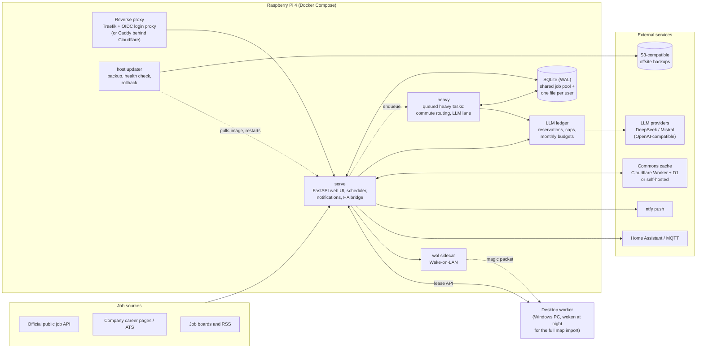

# job-search: a case study

**A self-hosted, LLM-assisted job search pipeline for IT jobs in Germany. It runs on a Raspberry Pi 4 and has a multi-user hosted mode, budgeted AI calls and its own CI/CD.**

This repository documents a private project by Lucas Keller ([github.com/xD33m](https://github.com/xD33m)): its architecture, a selection of its design decisions, its delivery pipeline and how its LLM steps are evaluated. The code itself is not published here.

> Every number below comes from the private repository's git history, its pull requests, its ADRs or its source tree as of the last commit (2026-10-13). Where a figure is a projection rather than a measurement, it says so.

---

## The problem

Looking for a software job in Germany means checking the same few places every day: job boards, dozens of company career pages, aggregators and RSS feeds. The same posting shows up several times under different titles. Many ads leave out the salary. "Hybrid" can mean anything from occasional office days to four a week. Whether a commute is acceptable depends on actual public-transport times, not distance.

job-search does that daily work on its own. It collects postings, merges duplicates and pulls structured facts out of free text with an LLM. It then estimates missing salaries against official wage statistics, computes real commute times and ranks what's left with a transparent, deterministic score. The morning notification holds the handful of jobs worth reading.

## What it does, end to end

1. **Fetch.** Scheduled adapters pull postings from an official public job API, company career pages (applicant-tracking-system endpoints, auto-detected from a careers URL), job boards and RSS feeds. A source layer respects robots.txt, paces requests and keeps an allowlist of sources per deploy mode.
2. **Normalise and dedupe.** Postings become *cards*. Matching on URL, exact keys and SimHash bands runs first, then a text-overlap stage (5-word shingles, Jaccard similarity) merges reposts. Borderline pairs go to the user as "possible duplicate" suggestions.
3. **Extract facts (LLM).** A small, cheap model turns each new card into a strictly typed record: contract type, remote mode and region, salary if stated, benefits, tech stack, seniority, required languages. The CV is not part of this call, so the facts depend only on the posting and can be shared between users.
4. **Salary.** Stated structured salary beats LLM-extracted salary, which beats an estimate. Code picks the estimate's bracket deterministically from official wage quartiles. The LLM only places the job inside that bracket, and code clamps the result.
5. **Commute.** A self-hosted [MOTIS](https://github.com/motis-project/motis) instance computes transit and car times from the user's home.
6. **Filter and score.** Each user's filters run on every card (permanent contract, remote or hybrid within commute range, salary target). A pure function then gives every card a 0–100 score with a stored, per-factor breakdown.
7. **Fit (LLM, per user).** Only for the top cards (or when a card is opened), a short "why it fits / red flags" text is generated against that user's CV.
8. **Notify and track.** A daily digest and push notifications ([ntfy](https://ntfy.sh)) whose action buttons are HMAC-signed, expiring links. Home Assistant entities over MQTT. A web UI with a job list, tracker, setup wizard and status page. A read-only IMAP sync matches replies to tracked applications, and an LLM turns them into stage suggestions the user confirms.
9. **Prepare (LLM, on demand).** A larger model drafts CV edits and a cover letter. A second LLM pass checks every factual claim in the draft against the CV, and the user reviews a diff before anything is exported to PDF. Nothing is ever submitted automatically.

## Architecture



More diagrams (the processing pipeline, the deployment topologies and the CI/release flow) are in [docs/architecture.md](docs/architecture.md).

**Stack:** Python 3.12 (uv, pyright strict, ruff), FastAPI with server-rendered Jinja templates, SQLAlchemy 2 and Alembic on SQLite, httpx, Pydantic, Playwright (end-to-end tests), paho-mqtt, RenderCV/Typst for PDFs, MOTIS for routing, a TypeScript Cloudflare Worker for the shared cache, PowerShell for the Windows power helper, GitHub Actions on self-hosted runners.

## Key numbers

| | |
|---|---|
| Development period | 2026-09-26 to 2026-10-13 (first to last commit) |
| Commits | 1,629 |
| Pull requests | 90 (89 merged, 1 closed), 2026-10-02 to 2026-10-13; earlier work went straight to `main` |
| Architecture decision records | 69 (ADR 0001–0069), each with context, options, evidence, decision and consequences |
| Application code | ~111k lines of Python in 597 modules under `src/` |
| Test code | ~189k lines; ~7,300 test functions; 10,739 test cases passed in the full-suite run recorded on 2026-10-07 |
| Quality gates | branch coverage ≥ 98 %, pyright strict, ruff, an OKF docs validator, AST-based architecture guards |
| CI/CD | 8 GitHub Actions workflows on 3 self-hosted runners (Linux desktop, Windows desktop, the Pi) |
| Runtime processes | `serve`, `heavy`, a Wake-on-LAN sidecar, a desktop worker; overlays for Traefik, Caddy/Cloudflare and the commons server |
| Measured LLM cost | ≈ $0.0005 per posting for fact extraction (strict mode, off-peak); see [EVALS.md](EVALS.md) |

## Engineering highlights

### 1. LLM integration

**One protocol, many providers.** Every LLM caller talks to a single `StructuredLLM` protocol: you pass a Pydantic model and a conversation, and you get back a validated instance or a typed error. One OpenAI-compatible client implements it, configured by a `ProviderProfile`. Adding Mistral next to DeepSeek turned every provider-specific behaviour into a field: strict-mode style, extra request body, usage parsing, price table, peak windows, output cap and retryable finish reasons. Retries, fallbacks, metering and tests stayed one code path. Tests use a typed fake that never builds a wire request. The real client is tested against a mock transport for every failure mode.

```python
class StructuredLLM(Protocol):
    def extract[T: BaseModel](
        self,
        tool: Tool[T],                     # the Pydantic model + the purpose it's billed under
        messages: Sequence[Message],       # system message(s), then user message(s)
        *,
        model: str,
        max_tokens: int,
        check: Callable[[T], str | None] | None = None,   # per-call rule the schema can't express
        deadline: Deadline | None = None,
    ) -> Result[T]: ...
```

**How outputs are validated.**
- Extraction uses provider-side strict structured output (a strict tool call, or `json_schema` on Mistral) at temperature 0 with reasoning disabled. If the strict endpoint refuses, the client falls back to JSON mode with the same Pydantic model.
- Pydantic adds range and consistency checks the provider can't enforce (salary bounds, min ≤ max, "salary stated" consistent with the amounts).
- A failed validation is retried *with the validation error appended*, at most twice, then the card is marked unscored. A spike showed that an identical retry at temperature 0 just reproduces the error.
- Structured source fields always win over LLM values. The LLM only fills fields the source left unknown, and the card records which fields came from the model.
- Untrusted text (job ads, emails, employer profiles) goes into delimited blocks the text itself can't close, under a standing "data, not instructions" rule. Control characters are normalised out of every parsed answer.
- Stored results are keyed by prompt version, input hash and a digest of the tool schema, so a prompt or schema change invalidates exactly what it should.
- For generated application documents, a grounding pass extracts every factual claim and checks it against the CV. A spike had shown the drafting model inventing a metric despite being told not to. Salary expectations and start dates come only from user settings, never from the model.

**Cost control.**
- A database-backed **ledger** reserves an estimated cost before every HTTP attempt and settles it with the real usage afterwards. The cap check and the insert share one `BEGIN IMMEDIATE` transaction, so the caps hold across threads *and* processes.
- Outcomes are booked conservatively: an unknown outcome (sent, no usable answer) is booked at its estimate, a lost settle expires into an estimated row, and the ledger fails closed when the database is unavailable.
- Personal mode has daily call caps per model class and a daily USD cap. Hosted mode gives every workspace a **hard monthly USD budget** (default $2.00), and each payer (the platform or a workspace) counts only its own rows.
- LLM work is scheduled outside the provider's peak-price windows, and the prompt prefix is kept byte-identical across a batch for prompt caching (≈72 % of prompt tokens cached on new postings, measured).
- A user may knowingly go over the personal daily cap for one generation they started after an explicit confirmation. Background work never can.

Details: [ADR 0003](docs/decisions/0003-llm-calls-and-validation.md), [ADR 0013](docs/decisions/0013-llm-extracts-code-scores.md), [ADR 0041](docs/decisions/0041-shared-facts-per-user-fit.md), [ADR 0049](docs/decisions/0049-provider-seam-payers-monthly-budget.md), [EVALS.md](EVALS.md).

### 2. DevOps

**Compose stacks sized for a Pi 4.** The base stack runs `app` (web, scheduler, notifications) and `heavy` (one queued heavy task at a time: transit routing, browser sessions, a second lane for LLM work) under explicit memory limits that add up to a documented 2.6 GiB budget. Overlays add Traefik with an OIDC login proxy, or a digest-pinned Caddy behind Cloudflare for a public host, or a commons server. A Wake-on-LAN sidecar talks to the app only over a Unix socket and is limited to personal installs by a Compose profile. The upstream MOTIS arm64 binary crashes on the Pi 4's Cortex-A72 (illegal instruction), so the project builds and pins its own MOTIS image.

**Change-aware CI ("run on a PR what its changes need").** Picking tests per PR would be unsafe here: the coverage gate is global, and the architecture, clock and network guards fail on changes far from their own files. So the unit of selection is the CI *job*, not the test. A small script maps the diff to jobs. Docs-only changes skip the suite, image inputs add a container smoke test, PowerShell changes add the Windows job, and any change to CI itself runs everything:

```sh
case "$file" in
  .github/workflows/*|scripts/ci_changes.sh|scripts/check.sh) all; exit 0 ;;
esac
case "$file" in docs/*|*.md) ;; *) code=true ;; esac
case "$file" in
  Dockerfile|.dockerignore|compose*.yaml|pyproject.toml|uv.lock|src/*|deploy/*) docker=true ;;
esac
case "$file" in *.ps1|*.psm1|*.psd1) powershell=true ;; esac
```

A nightly run on `main` covers the rest: the whole suite at three fixed clock instants (a weekday peak-price morning, the October DST night, New Year's Eve), plus the multi-arch build. It skips the night when `main` already passed. Because merges often happen without waiting for the PR run, every push to `main` runs its own change-aware check, in a concurrency group of its own so a later merge can't cancel it. All third-party actions are pinned to commit SHAs.

**Self-hosted runners.** The suite took 25–50 minutes on 2-vCPU hosted runners and about 4 minutes on the desktop. CI therefore runs on a containerised Linux runner with its own Docker-in-Docker daemon, plus a native Windows runner for the PowerShell checks.

**The Pi builds its own arm64 image.** The desktop is often off, and its multi-arch release spent most of its ~18 minutes emulating arm64 under QEMU. So a third runner lives on the Pi as a systemd service (`MemoryMax=768M`, `Nice=10`, its own unprivileged user). On every merge it:
1. builds `linux/arm64` natively in a persistent BuildKit builder capped at 2 of 4 cores and 2 GB (272 s cold, **16 s** for a code change, measured);
2. pushes, pulls back by digest and smoke-tests the image;
3. moves the `pi` tag and asks the host updater to install it.

The desktop's `release` workflow keeps publishing the multi-arch `latest`, and moves it only after the amd64 image passed its smoke test by digest.

**Release flow with rollback.** Images carry their version, revision and release notes as labels. A small standard-library updater on the host (started by systemd on the app's request) refuses while work is running. It then takes and verifies a backup, pulls the channel tag, restarts with the compose files the stack was started with, and rolls back image and database if the new version doesn't turn healthy. The first automatic update after the Pi moved to hosted mode failed safely: the compose config check refused, nothing restarted, the app kept running on the previous image, and the fix shipped in the next PR. Backups can go encrypted (AES-256-GCM) to any S3-compatible bucket, and a weekly drill restores the newest set into a scratch folder.

Details: [ADR 0034](docs/decisions/0034-self-hosted-runners-change-aware-ci.md), [ADR 0044](docs/decisions/0044-pi-builds-its-own-image.md), [ADR 0039](docs/decisions/0039-published-images-and-self-update.md).

### 3. The multi-user hosted edition

The app started as one instance per person. A `personal` / `hosted` deploy mode now lets one codebase also serve many users.

- **Data isolation by construction.** Hosted mode keeps a shared SQLite file (the job pool and infrastructure) plus **one SQLite file per user**, joined with `ATTACH`. This was chosen over `user_id` columns or Postgres with row-level security: a forgotten tenant filter can't leak someone's CV, and export or deletion are file operations. Job facts are shared, while fit, filters, tracker and CV stay per user.
- **Accounts and sessions.** Sessions are server-side behind a `__Host-` cookie, stored only as a SHA-256 hash, sliding 30 days. Magic links are single-use, last 15 minutes and are stored hashed. Opening a link shows a confirm page and only a POST consumes it, so an email scanner's prefetch can't burn the link. The login form answers identically whether or not an address exists.
- **OAuth without a framework.** GitHub and Google sign-in are two hand-written authorization-code flows with PKCE over httpx, linked by verified email. This added no new dependency and no second session mechanism, and every request can be faked in tests. Turnstile guards the two anonymous forms.
- **Behind a login proxy.** On the Pi, sign-in is delegated to a self-hosted OIDC provider behind Traefik. The app requires a shared proxy secret on every request and only honours a session for the address the proxy vouches for. Behind the proxy, the anonymous login routes aren't mounted at all.
- **Roles, plans and limits.** An admin role handles invites, plan grants, disabling and deletion. Feature flags apply per account, and every Pro feature is checked again *right before the AI call*, so work queued before a revoke can't run. Monthly AI budget and other limits come from the plan, with per-account overrides.
- **Retention.** Accounts unused for 12 months are deleted after a warning 30 days before. Users can export or delete their own data at any time.
- **Cutover.** Moving the owner's existing database into the split layout was rehearsed on a copy, then run live with the runbook. A pre-split copy of the database was kept for rollback.

Hosted mode also restricts sources to an allowlist whose terms permit that use. A public, paid launch was designed but isn't built. Today the hosted mode serves a small invite-only group on the owner's Pi.

Details: [ADR 0048](docs/decisions/0048-hosted-accounts-and-auth.md), [ADR 0049](docs/decisions/0049-provider-seam-payers-monthly-budget.md).

### 4. How AI coding tools were used, and how their output was reviewed

The project was built with Claude Code as the main implementer. Here is what the repository itself shows:

- **Attribution.** 1,521 of the 1,629 commits carry a `Co-Authored-By` trailer for a Claude model. Every document in `docs/` has provenance front matter (`generated: {by: claude-code/<model>, at: …}`). A separate `verified: human:<name>` field is reserved for content the owner explicitly approved.
- **Written rules for the agent.** A `CLAUDE.md` names the agreed specification as the source of truth and requires an ADR for every non-trivial decision. It also sets the quality bar (strict typing, fixture-based tests, end-to-end tests, spikes before risky phases) and limits the agent's autonomy: changes to scope, spending money, irreversible actions and anything needing the owner's credentials or hardware go back to the owner.
- **Plans before code.** Each phase had a written plan with tasks and "done when" criteria. The quality-refactor plan, for example, required a failing test first, then the fix, then a commit per task.
- **Review gates.** A phase is only done after a code-review pass over its whole branch. The effort level is set by risk: high for hosted, money, privacy or legal code. After the first 14 build phases, a whole-codebase architecture and quality review found about 240 verified problems. A nine-phase refactor fixed them without cutting scope, each phase ending in its own review gate.
- **Mechanical guards, so review doesn't depend on attention alone.** AST-based architecture tests enforce import boundaries: web routes never open write transactions, and LLM task modules can't import domain packages. Other guards block non-loopback network access in tests and wall-clock reads outside an injected clock. A 98 % branch-coverage gate, pyright strict and a pre-commit hook complete the set.
- **Evidence labels.** Research and ADR claims are marked as verified by a live request or measurement, or as inferred from documentation. Spikes against real APIs and real hardware come before decisions that depend on them.

## Selected decisions

| ADR | Topic |
|---|---|
| [0003](docs/decisions/0003-llm-calls-and-validation.md) | LLM calls: strict structured output, validation-driven retries, deterministic merge, a ledger |
| [0013](docs/decisions/0013-llm-extracts-code-scores.md) | The LLM extracts facts; code scores, with a label-based evaluation harness |
| [0041](docs/decisions/0041-shared-facts-per-user-fit.md) | CV-free job facts shared across users; the per-user fit as a separate, lazy call |
| [0049](docs/decisions/0049-provider-seam-payers-monthly-budget.md) | Provider profiles, a payer on every call, a hard monthly AI budget |
| [0034](docs/decisions/0034-self-hosted-runners-change-aware-ci.md) | Self-hosted runners and change-aware CI |
| [0044](docs/decisions/0044-pi-builds-its-own-image.md) | The Raspberry Pi builds and installs its own arm64 image |
| [0039](docs/decisions/0039-published-images-and-self-update.md) | Published images and a self-update with backup, health check and rollback |
| [0048](docs/decisions/0048-hosted-accounts-and-auth.md) | Hosted accounts: sessions, magic links, OAuth with PKCE, retention |

These are condensed rewrites. The originals are much longer and include amendments, evidence and test references.

## Why the code is private

The project includes source adapters and personal configuration that aren't suitable for publication, so this case study documents the design instead.

## Contact

Lucas Keller · [github.com/xD33m](https://github.com/xD33m)

---

<sub>The text and diagrams in this repository are licensed under [CC BY 4.0](https://creativecommons.org/licenses/by/4.0/). Short illustrative snippets are excerpts from a private codebase and are shown for explanation only.</sub>
