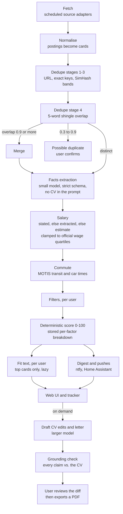
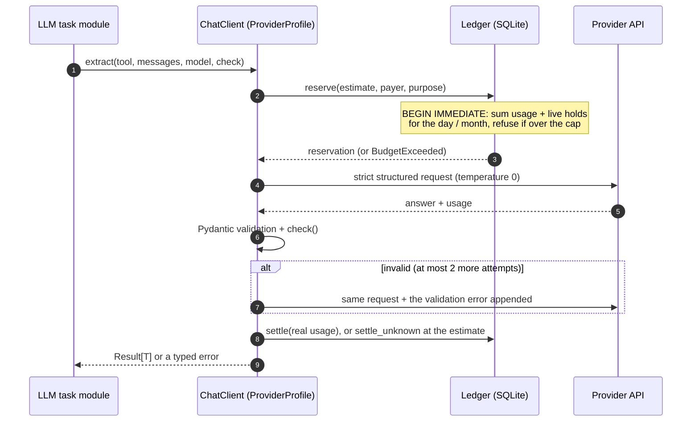
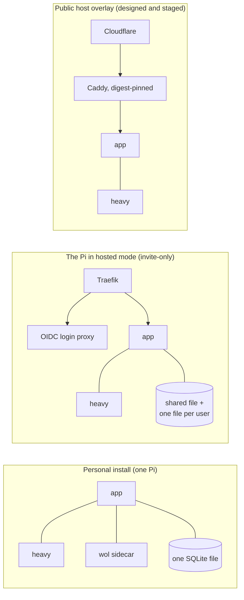
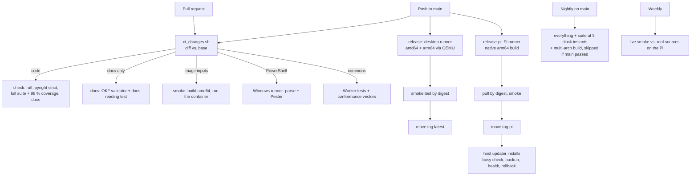

# Architecture

This page adds four views to the component diagram in the [README](../README.md): the processing pipeline, one LLM call, the deployment topologies and the CI/release flow. Names match the private codebase. Internal hostnames, addresses and source-specific details are left out.

## 1. Processing pipeline

Each heavy stage queues the next one when it finishes. Queue items run under database leases with heartbeats and a watchdog, so a crashed or hung worker gives its task back instead of holding it forever. The facts call depends only on the posting. Its result can therefore be shared across users, and between separate installs through the *commons*: a content-addressed, first-write-wins cache served by a Cloudflare Worker with D1, or by a self-hosted server. Both implementations pass the same conformance vectors.

## 2. One LLM call

No write transaction is held across the HTTP call. The protocol refuses a call made while one is open. If a settle fails, the reservation later expires into an estimated usage row, so spend can be over-counted but never under-counted.

## 3. Deployment topologies

- **Personal:** the base Compose file. A Compose profile limits the Wake-on-LAN sidecar to this mode. It wakes a Windows desktop at night for the full map import, and afterwards a PowerShell power helper on the PC asks the Pi whether to power down. It acts only on an answer signed with its worker token and bound to the nonce it just sent, so a replayed or unsigned answer never powers anything down. The Pi in hosted mode keeps using the desktop worker.
- **Pi, hosted mode:** the same stack plus a Traefik overlay. Sign-in is delegated to a self-hosted OIDC provider. The app checks a shared proxy secret on every request.
- **Public overlay:** Caddy is the only service with published ports. It accepts traffic from Cloudflare's ranges with an Origin CA certificate. Uvicorn trusts forwarded headers only from Caddy's fixed address. This overlay passed a ten-step staging smoke run on the Pi. A real public server is not in use.

## 4. CI and release flow

Installs follow a *channel* tag. The Pi follows `pi`, everyone else `latest`. The status page shows when a newer image exists and what changed, drawn from the release notes baked into the image labels.
